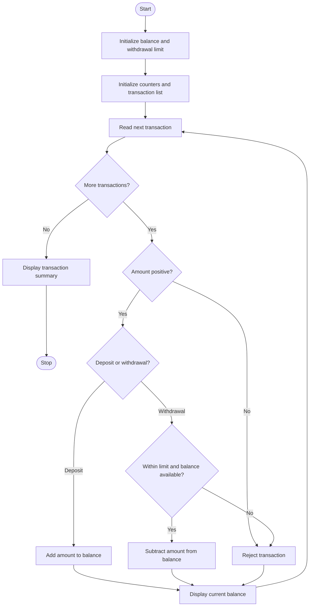

# ATM
# Case Study 9
## ATM Transaction Sequence Simulation

### Problem Statement
The ATM Transaction Sequence Simulation program processes a sequence of deposits and withdrawals. It maintains the account balance, allows valid transactions, enforces withdrawal limits, rejects invalid transactions, and displays a final transaction summary.

### Objectives
- Simulate ATM deposit and withdrawal operations.
- Maintain the account balance after each transaction.
- Enforce a maximum withdrawal limit.
- Reject invalid amounts and withdrawals.
- Display successful transactions and transaction summary.

### Assumptions
1. The initial account balance is Rs. 5000.
2. The maximum withdrawal limit is Rs. 2000 per transaction.
3. Deposit and withdrawal amounts must be positive.
4. Withdrawals cannot exceed the available balance.
5. Invalid transactions are rejected.
6. Transactions are predefined in a list.

### Algorithm
1. Start the program.
2. Initialize the balance to Rs. 5000.
3. Set the withdrawal limit to Rs. 2000.
4. Initialize deposit, withdrawal, and rejected transaction counters.
5. Store the transactions in a list.
6. Read each transaction from the list.
7. Check whether the amount is positive.
8. If the amount is invalid, reject the transaction.
9. If the transaction is a deposit, add the amount to the balance.
10. If the transaction is a withdrawal, check the withdrawal limit and available balance.
11. If valid, subtract the amount from the balance.
12. Otherwise, reject the withdrawal.
13. Display the updated balance.
14. Repeat for all transactions.
15. Display the transaction summary and history.
16. Stop.

### Flowchart



### Pseudocode
```text
BEGIN
    balance = 5000
    withdrawal_limit = 2000
    initialize counters

    FOR each transaction
        IF amount <= 0
            reject transaction
        ELSE IF transaction is Deposit
            balance = balance + amount
        ELSE IF transaction is Withdrawal
            IF amount > withdrawal_limit
                reject transaction
            ELSE IF amount > balance
                reject transaction
            ELSE
                balance = balance - amount
            END IF
        END IF
        display balance
    END FOR

    display transaction summary
END
```

### Python Source Code
The program is available in `atm_simulation.py`.

### Test Cases

| Test | Transaction | Amount | Expected Result |
|---|---|---:|---|
| 1 | Deposit | Rs. 1500 | Successful |
| 2 | Withdrawal | Rs. 1000 | Successful |
| 3 | Withdrawal | Rs. 2500 | Rejected: Limit exceeded |
| 4 | Deposit | Rs. 500 | Successful |
| 5 | Withdrawal | Rs. 2000 | Successful |
| 6 | Withdrawal | Rs. -300 | Rejected: Invalid amount |
| 7 | Deposit | Rs. 0 | Rejected: Invalid amount |

### Sample Output
```text
===== ATM TRANSACTION SIMULATION =====
Initial Balance: Rs. 5000

Transaction: Deposit | Amount: Rs. 1500
Deposit successful.
Current Balance: Rs. 6500

Transaction: Withdraw | Amount: Rs. 1000
Withdrawal successful.
Current Balance: Rs. 5500

Transaction: Withdraw | Amount: Rs. 2500
Rejected: Withdrawal limit exceeded.
Current Balance: Rs. 5500

Transaction: Deposit | Amount: Rs. 500
Deposit successful.
Current Balance: Rs. 6000

Transaction: Withdraw | Amount: Rs. 2000
Withdrawal successful.
Current Balance: Rs. 4000

Transaction: Withdraw | Amount: Rs. -300
Rejected: Amount must be positive.
Current Balance: Rs. 4000

Transaction: Deposit | Amount: Rs. 0
Rejected: Amount must be positive.
Current Balance: Rs. 4000

===== TRANSACTION SUMMARY =====
Initial Balance: Rs. 5000
Total Deposits: Rs. 2000
Total Withdrawals: Rs. 3000
Rejected Transactions: 3
Number of Successful Transactions: 4
Final Balance: Rs. 4000

Successful Transaction History:
Deposit: Rs. 1500
Withdrawal: Rs. 1000
Deposit: Rs. 500
Withdrawal: Rs. 2000
```

### Conclusion
The ATM Transaction Sequence Simulation successfully processes deposits and withdrawals, maintains the account balance, enforces withdrawal limits, and rejects invalid transactions. It demonstrates Python lists, loops, conditional statements, arithmetic operations, and basic transaction tracking.
